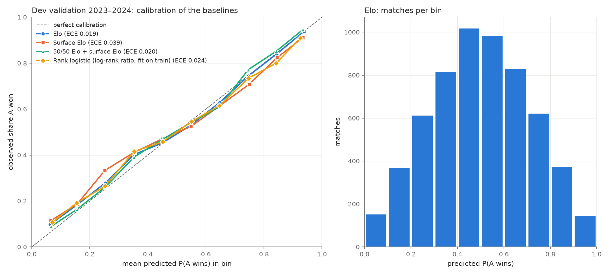

# Phase 3 — Baselines on the dev split

Generated by `python -m tennis.model.evaluate` on 2026-11-16 · config hash `1f47f5c50fc9` · git `cc0bd585268561f301ca54f0b408f36e59f6ada1`. Every run is a JSON line in `experiments/baselines.jsonl`.

**Dev split** (DECISIONS D-004): train 2000-01-01 → 2022-12-31 (66,363 rows), validation 2023-01-01 → 2024-12-31 (5,928 rows). **There is no test set in this split**; nothing here touches Wimbledon 2025 or 2026.

CIs: 95% percentile bootstrap over validation rows, 2,000 resamples, seed `42`. Accuracy gives half credit to a no-pick (p = 0.5: equal Elo, equal or both-missing rank). RET/DEF matches are never labels and are absent from every table, so accuracies are slightly optimistic relative to all real matches (D-022).

## Validation 2023–2024

| Baseline | n | Accuracy | Log loss | Brier |
|---|---|---|---|---|
| Higher rank wins | 5,928 | 0.6385 [0.6259, 0.6504] | — | — |
| Rank logistic (log-rank ratio, fit on train) | 5,928 | 0.6385 [0.6259, 0.6504] | 0.6297 [0.6196, 0.6395] | 0.2202 [0.2158, 0.2246] |
| Elo | 5,928 | 0.6553 [0.6430, 0.6666] | 0.6099 [0.5997, 0.6207] | 0.2118 [0.2075, 0.2163] |
| Surface Elo | 5,928 | 0.6452 [0.6334, 0.6576] | 0.6214 [0.6098, 0.6325] | 0.2167 [0.2119, 0.2214] |
| 50/50 Elo + surface Elo | 5,928 | 0.6565 [0.6447, 0.6684] | 0.6056 [0.5957, 0.6156] | 0.2102 [0.2060, 0.2145] |
| Bookmaker (implied, margin removed) | — | TODO (Phase 6/7): bookmaker implied probability, margin removed — odds being ingested | TODO | TODO |

- *Higher rank wins* has no probability (accuracy only). Its probabilistic twin, the *rank logistic*, is `P(A) = sigmoid(β·(ln b_rank − ln a_rank))` with no intercept, fitted on TRAIN rows only: β = 0.6238; unranked players get rank 2160 (largest training rank + 1). Its picks are identical to the rule, so its accuracy is the rule's.
- The 50/50 blend averages the two Elo probabilities.
- Leakage alarm: every full-window and full-season accuracy above is ≤ 0.75 (checked by `leakage_alarm`).

**Paired differences vs Elo** (same validation rows, paired bootstrap; negative log-loss difference = better than Elo):

| Baseline − Elo | Δ accuracy | Δ log loss |
|---|---|---|
| Rank logistic (log-rank ratio, fit on train) | -0.0168 [-0.0271, -0.0068] | +0.0198 [+0.0135, +0.0264] |
| Surface Elo | -0.0101 [-0.0205, +0.0007] | +0.0115 [+0.0038, +0.0189] |
| 50/50 Elo + surface Elo | +0.0012 [-0.0062, +0.0093] | -0.0043 [-0.0080, -0.0007] |

## Per season 2015–2024 (accuracy)

Seasons ≤ 2022 lie in the training window. Elo and the rank rule fit nothing on those rows (Elo is a pre-match rating), so they are still honest out-of-sample predictions; the rank logistic's β is in-sample there. 2023–2024 are the validation seasons.

| Season | n | Rank rule | Elo | Surface Elo | Blend | Elo log loss |
|---|---|---|---|---|---|---|
| 2015 | 2,833 | 0.6917 [0.675, 0.707] | 0.7007 [0.684, 0.718] | 0.6966 [0.680, 0.715] | 0.7024 [0.685, 0.719] | 0.5618 |
| 2016 | 2,825 | 0.6819 [0.665, 0.699] | 0.6998 [0.684, 0.717] | 0.6981 [0.682, 0.714] | 0.7034 [0.687, 0.720] | 0.5728 |
| 2017 | 2,785 | 0.6596 [0.641, 0.677] | 0.6855 [0.668, 0.702] | 0.6756 [0.658, 0.692] | 0.6880 [0.672, 0.704] | 0.5931 |
| 2018 | 2,889 | 0.6430 [0.625, 0.661] | 0.6573 [0.640, 0.675] | 0.6518 [0.634, 0.669] | 0.6611 [0.643, 0.679] | 0.6175 |
| 2019 | 2,632 | 0.6178 [0.600, 0.636] | 0.6493 [0.631, 0.668] | 0.6565 [0.639, 0.675] | 0.6630 [0.645, 0.682] | 0.6173 |
| 2020 | 1,430 | 0.6465 [0.620, 0.671] | 0.6542 [0.628, 0.679] | 0.6619 [0.637, 0.686] | 0.6689 [0.644, 0.694] | 0.6074 |
| 2021 | 2,644 | 0.6392 [0.622, 0.658] | 0.6590 [0.641, 0.677] | 0.6475 [0.630, 0.665] | 0.6579 [0.640, 0.676] | 0.6073 |
| 2022 | 2,820 | 0.6512 [0.634, 0.669] | 0.6647 [0.647, 0.682] | 0.6626 [0.646, 0.680] | 0.6750 [0.658, 0.693] | 0.5942 |
| 2023 | 2,888 | 0.6363 [0.619, 0.653] | 0.6562 [0.639, 0.673] | 0.6380 [0.620, 0.655] | 0.6541 [0.636, 0.670] | 0.6131 |
| 2024 | 3,040 | 0.6406 [0.624, 0.658] | 0.6544 [0.638, 0.672] | 0.6520 [0.635, 0.669] | 0.6587 [0.642, 0.676] | 0.6068 |

## Validation 2023–2024 by surface

| Surface | n | Rank rule acc | Elo acc | Surface Elo acc | Blend acc | Elo log loss | Blend log loss |
|---|---|---|---|---|---|---|---|
| Clay | 1,822 | 0.628 [0.605, 0.651] | 0.635 [0.613, 0.658] | 0.635 [0.612, 0.658] | 0.647 [0.625, 0.669] | 0.6264 | 0.6159 |
| Grass | 640 | 0.634 [0.595, 0.672] | 0.664 [0.627, 0.700] | 0.598 [0.561, 0.636] | 0.634 [0.597, 0.670] | 0.5990 | 0.6092 |
| Hard | 3,466 | 0.645 [0.630, 0.661] | 0.664 [0.649, 0.681] | 0.659 [0.645, 0.675] | 0.665 [0.651, 0.682] | 0.6032 | 0.5995 |

## Validation 2023–2024 by level

| Level | n | Rank rule acc | Elo acc | Surface Elo acc | Blend acc | Elo log loss | Blend log loss |
|---|---|---|---|---|---|---|---|
| A | 3,041 | 0.614 [0.596, 0.632] | 0.639 [0.622, 0.657] | 0.625 [0.608, 0.642] | 0.639 [0.622, 0.657] | 0.6260 | 0.6253 |
| G | 983 | 0.696 [0.666, 0.724] | 0.715 [0.689, 0.743] | 0.709 [0.680, 0.737] | 0.715 [0.687, 0.743] | 0.5375 | 0.5323 |
| M | 1,344 | 0.638 [0.612, 0.663] | 0.643 [0.617, 0.667] | 0.643 [0.616, 0.668] | 0.645 [0.619, 0.670] | 0.6326 | 0.6216 |
| F | 29 | 0.759 [0.586, 0.897] | 0.690 [0.517, 0.862] | 0.655 [0.483, 0.828] | 0.690 [0.517, 0.862] | 0.5696 | 0.5651 |
| D | 468 | 0.658 [0.613, 0.700] | 0.657 [0.612, 0.697] | 0.640 [0.596, 0.679] | 0.663 [0.621, 0.702] | 0.6133 | 0.6061 |
| O | 63 | 0.746 [0.635, 0.841] | 0.730 [0.619, 0.841] | 0.714 [0.603, 0.825] | 0.778 [0.667, 0.873] | 0.4697 | 0.4735 |

## Validation 2023–2024 by round

| Round | n | Rank rule acc | Elo acc | Surface Elo acc | Blend acc | Elo log loss | Blend log loss |
|---|---|---|---|---|---|---|---|
| R128 | 810 | 0.635 [0.602, 0.669] | 0.651 [0.617, 0.684] | 0.643 [0.611, 0.675] | 0.648 [0.615, 0.681] | 0.5985 | 0.5908 |
| R64 | 866 | 0.647 [0.613, 0.679] | 0.657 [0.626, 0.687] | 0.652 [0.620, 0.682] | 0.665 [0.633, 0.696] | 0.6051 | 0.5959 |
| R32 | 1,753 | 0.634 [0.612, 0.658] | 0.654 [0.633, 0.678] | 0.651 [0.627, 0.674] | 0.653 [0.631, 0.675] | 0.6067 | 0.6058 |
| R16 | 1,008 | 0.638 [0.608, 0.666] | 0.674 [0.645, 0.702] | 0.651 [0.621, 0.679] | 0.667 [0.637, 0.696] | 0.6157 | 0.6083 |
| RR | 591 | 0.658 [0.620, 0.695] | 0.656 [0.618, 0.694] | 0.632 [0.593, 0.671] | 0.657 [0.618, 0.695] | 0.6140 | 0.6086 |
| QF | 497 | 0.644 [0.600, 0.682] | 0.650 [0.610, 0.694] | 0.648 [0.608, 0.688] | 0.662 [0.620, 0.704] | 0.6168 | 0.6160 |
| SF | 265 | 0.608 [0.547, 0.664] | 0.626 [0.566, 0.683] | 0.626 [0.566, 0.683] | 0.645 [0.585, 0.698] | 0.6235 | 0.6201 |
| BR | 1 | 1.000 [1.000, 1.000] | 0.000 [0.000, 0.000] | 1.000 [1.000, 1.000] | 1.000 [1.000, 1.000] | 0.6962 | 0.6059 |
| F | 137 | 0.620 [0.540, 0.701] | 0.628 [0.547, 0.708] | 0.577 [0.496, 0.657] | 0.613 [0.533, 0.701] | 0.6341 | 0.6520 |

Level codes: G Grand Slam, M Masters 1000, A other tour events (incl. NextGen Finals), F Tour Finals, D Davis Cup, O Olympics. Small groups have wide CIs (the single BR row is meaningless).

**Subgroups above the 0.75 alarm line:** Higher rank wins on level = F (0.759, n = 29); Rank logistic (log-rank ratio, fit on train) on level = F (0.759, n = 29); 50/50 Elo + surface Elo on level = O (0.778, n = 63); Higher rank wins on round = BR (1.000, n = 1); Rank logistic (log-rank ratio, fit on train) on round = BR (1.000, n = 1); Surface Elo on round = BR (1.000, n = 1); 50/50 Elo + surface Elo on round = BR (1.000, n = 1). These are small subgroups, not full-season accuracies (the alarm's scope); their CIs reach far below the line and the matching Elo figures are ordinary, so no leakage is suspected. Subgroup figures are kept out of the JSON log for that reason.

## Partition sizes of every configured split

Row counts and date ranges only — no metric is computed on any test partition. *Unassigned* rows fall in no partition: for `dev`, everything from 2025 on; for `replication`, every event starting after val_end 2025-06-29 other than Wimbledon 2025 (rest of 2025 and all of 2026); for `forward`, only rows after the pinned test_end (none today).

| Split | Train | Val | Test | Unassigned |
|---|---|---|---|---|
| dev | 66,363 (2000-01-03 → 2022-11-27) | 5,928 (2023-01-02 → 2024-12-30) | — | 4,130 |
| replication | 72,291 (2000-01-03 → 2024-12-30) | 1,493 (2025-01-06 → 2025-06-23) | 122 (2025-06-30 → 2025-06-30) | 2,515 |
| forward | 75,016 (2000-01-03 → 2025-12-17) | 932 (2026-01-04 → 2026-03-30) | 473 (2026-04-05 → 2026-05-25) | 0 |

## Calibration (validation 2023–2024)

Elo, 10 equal-width bins:

| Bin | n | Mean predicted | Observed share |
|---|---|---|---|
| 0.0–0.1 | 153 | 0.063 | 0.098 |
| 0.1–0.2 | 369 | 0.154 | 0.182 |
| 0.2–0.3 | 613 | 0.254 | 0.279 |
| 0.3–0.4 | 816 | 0.352 | 0.402 |
| 0.4–0.5 | 1,019 | 0.451 | 0.453 |
| 0.5–0.6 | 985 | 0.548 | 0.530 |
| 0.6–0.7 | 831 | 0.648 | 0.629 |
| 0.7–0.8 | 622 | 0.747 | 0.744 |
| 0.8–0.9 | 374 | 0.844 | 0.840 |
| 0.9–1.0 | 146 | 0.938 | 0.938 |

Expected calibration error (count-weighted |pred − obs|): Elo 0.0186, Surface Elo 0.0385, 50/50 Elo + surface Elo 0.0205, Rank logistic (log-rank ratio, fit on train) 0.0237.
