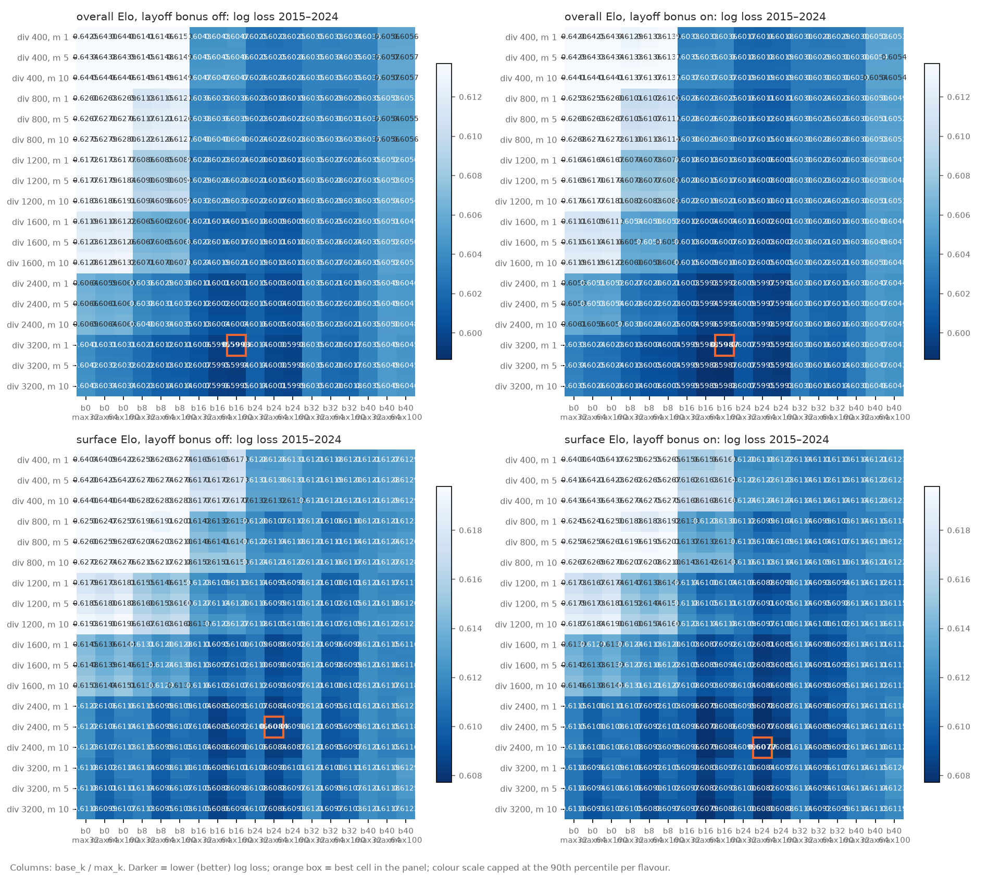
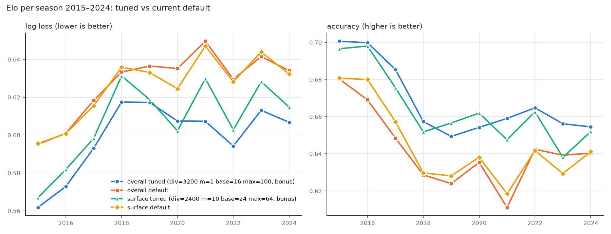

# Phase 4 — Elo tuning

Generated by `python -m tennis.model.elo_harness` · config hash `26939b7ea343` · git `cc0bd585268561f301ca54f0b408f36e59f6ada1`. One JSON line per grid point in `experiments/elo_tuning.jsonl`.

**Walk:** 336,157 non-walkover matches 1990 → 2026 (all levels incl. Challenger and qualifying, RET/DEF included as played but not moving Elo) in the authoritative order, with the engine's rules (m_mode `event_matches_so_far`, RR blocks from pre-block state, layoff bonus as `k_bonus_after_layoff`). The harness reproduces the feature table's `a_elo`/`a_elo_surface` exactly under the current config (test `test_harness_matches_feature_table`).

**Scored:** 26,786 matches: training-level, not qualifying, not RET/DEF, tourney_date in 2015-01-01 … 2024-12-31, after the first 10,000 processed matches. No test period is touched (Wimbledon 2025; 2026-04-01 → 2026-06-07). Metric: log loss of the Elo probability (primary), accuracy (half credit at p = 0.5) and Brier as tie-breaker/context.

**Caveat (D-004):** the tuning window 2015–2024 contains the dev validation window 2023–2024 used by Phase 5. That is selection overlap on validation data only (Elo hyper-parameters chosen with 2023–24 in view), not test contamination; the Phase 5 validation numbers for Elo are therefore slightly optimistic relative to a truly unseen window.

**Grid:** 650 settings per flavour (div_number × m × base_k × max_k × bonus, plus fixed K = 24 with bonus off/on), overall and surface tuned separately. Runtime: prepare 2.0s, grid 83.0s on 11 processes.

## Overall Elo — top 15 of 650

| # | Setting | Log loss | Accuracy | Brier |
|---|---|---|---|---|
| 1 | div=3200 m=1 base=16 max=100, bonus | 0.59865 | 0.6689 | 0.20676 |
| 2 | div=3200 m=5 base=16 max=100, bonus | 0.59869 | 0.6688 | 0.20677 |
| 3 | div=3200 m=10 base=16 max=100, bonus | 0.59877 | 0.6693 | 0.20681 |
| 4 | div=3200 m=1 base=16 max=64, bonus | 0.59879 | 0.6690 | 0.20681 |
| 5 | div=3200 m=5 base=16 max=64, bonus | 0.59882 | 0.6692 | 0.20682 |
| 6 | div=3200 m=10 base=16 max=64, bonus | 0.59887 | 0.6695 | 0.20685 |
| 7 | div=2400 m=1 base=16 max=100, bonus | 0.59924 | 0.6688 | 0.20701 |
| 8 | div=3200 m=1 base=24 max=100, bonus | 0.59925 | 0.6696 | 0.20690 |
| 9 | div=3200 m=5 base=24 max=100, bonus | 0.59927 | 0.6693 | 0.20690 |
| 10 | div=2400 m=1 base=16 max=64, bonus | 0.59930 | 0.6690 | 0.20704 |
| 11 | div=3200 m=10 base=24 max=100, bonus | 0.59932 | 0.6692 | 0.20693 |
| 12 | div=3200 m=1 base=16 max=100, no bonus | 0.59933 | 0.6679 | 0.20705 |
| 13 | div=2400 m=5 base=16 max=100, bonus | 0.59937 | 0.6690 | 0.20707 |
| 14 | div=3200 m=5 base=16 max=100, no bonus | 0.59940 | 0.6681 | 0.20708 |
| 15 | div=2400 m=5 base=16 max=64, bonus | 0.59940 | 0.6688 | 0.20708 |
| … |  |  |  |  |
| 625 | **current default** (div=800 m=1 base=0 max=100, no bonus) | 0.62690 | 0.6425 | 0.21895 |
| 650 | worst (div=400 m=10 base=0 max=64, no bonus) | 0.64457 | 0.6331 | 0.22669 |

Best minus reference, paired bootstrap over the scored matches (2,000 resamples; negative Δ log loss = best is better):

| Reference | Δ log loss | Δ accuracy |
|---|---|---|
| runner-up (div=3200 m=5 base=16 max=100, bonus) | -0.00004 [-0.00009, +0.00002] | +0.0000 [-0.0004, +0.0006] |
| best fixed K (fixed K=24, bonus) | -0.00329 [-0.00449, -0.00206] | +0.0024 [-0.0003, +0.0052] |
| best without layoff bonus (div=3200 m=1 base=16 max=100, no bonus) | -0.00068 [-0.00093, -0.00044] | +0.0010 [-0.0001, +0.0020] |
| current default (div=800 m=1 base=0 max=100, no bonus) | -0.02824 [-0.03101, -0.02519] | +0.0264 [+0.0215, +0.0312] |

**Beyond-grid probe** — the best sits on a grid edge, so one step past each edge was scored (diagnostic only; not selectable under the configured grid):

| Probe | Log loss | Δ vs grid best | Accuracy |
|---|---|---|---|
| div=4000 m=1 base=16 max=100, bonus | 0.59855 | -0.00011 | 0.6693 |
| div=3200 m=1 base=16 max=136, bonus | 0.59881 | +0.00015 | 0.6692 |
| div=4000 m=1 base=16 max=136, bonus | 0.59869 | +0.00003 | 0.6691 |

### Overall Elo — effect of each hyper-parameter (dynamic-K settings)

| Hyper-parameter | Value | Settings | Mean log loss | Best log loss | Mean accuracy |
|---|---|---|---|---|---|
| div_number | 400.0 | 108 | 0.61198 | 0.60161 | 0.6582 |
| div_number | 800.0 | 108 | 0.60846 | 0.60106 | 0.6612 |
| div_number | 1200.0 | 108 | 0.60616 | 0.60051 | 0.6635 |
| div_number | 1600.0 | 108 | 0.60457 | 0.60011 | 0.6652 |
| div_number | 2400.0 | 108 | 0.60266 | 0.59924 | 0.6670 |
| div_number | 3200.0 | 108 | 0.60172 | 0.59865 | 0.6677 |
| m | 1.0 | 216 | 0.60573 | 0.59865 | 0.6639 |
| m | 5.0 | 216 | 0.60591 | 0.59869 | 0.6638 |
| m | 10.0 | 216 | 0.60613 | 0.59877 | 0.6636 |
| base_k | 0.0 | 108 | 0.61816 | 0.60233 | 0.6516 |
| base_k | 8.0 | 108 | 0.60738 | 0.60035 | 0.6598 |
| base_k | 16.0 | 108 | 0.60177 | 0.59865 | 0.6652 |
| base_k | 24.0 | 108 | 0.60114 | 0.59925 | 0.6677 |
| base_k | 32.0 | 108 | 0.60267 | 0.60136 | 0.6687 |
| base_k | 40.0 | 108 | 0.60443 | 0.60299 | 0.6697 |
| max_k | 32.0 | 216 | 0.60596 | 0.59986 | 0.6633 |
| max_k | 64.0 | 216 | 0.60588 | 0.59879 | 0.6641 |
| max_k | 100.0 | 216 | 0.60592 | 0.59865 | 0.6640 |
| bonus_after_layoff | False | 324 | 0.60629 | 0.59933 | 0.6635 |
| bonus_after_layoff | True | 324 | 0.60556 | 0.59865 | 0.6641 |
| fixed K = 24 | False | 1 | 0.60265 | 0.60265 | 0.6666 |
| fixed K = 24 | True | 1 | 0.60194 | 0.60194 | 0.6665 |

## Surface Elo — top 15 of 650

| # | Setting | Log loss | Accuracy | Brier |
|---|---|---|---|---|
| 1 | div=2400 m=10 base=24 max=64, bonus | 0.60772 | 0.6641 | 0.21021 |
| 2 | div=2400 m=5 base=24 max=64, bonus | 0.60774 | 0.6647 | 0.21017 |
| 3 | div=2400 m=1 base=24 max=64, bonus | 0.60779 | 0.6659 | 0.21016 |
| 4 | div=2400 m=5 base=16 max=64, bonus | 0.60785 | 0.6641 | 0.21030 |
| 5 | div=2400 m=10 base=16 max=64, bonus | 0.60786 | 0.6637 | 0.21035 |
| 6 | div=2400 m=1 base=16 max=64, bonus | 0.60788 | 0.6650 | 0.21028 |
| 7 | div=3200 m=10 base=16 max=64, bonus | 0.60794 | 0.6639 | 0.21021 |
| 8 | div=3200 m=10 base=24 max=64, bonus | 0.60801 | 0.6657 | 0.21018 |
| 9 | div=2400 m=10 base=24 max=100, bonus | 0.60809 | 0.6652 | 0.21022 |
| 10 | div=1600 m=1 base=24 max=64, bonus | 0.60812 | 0.6637 | 0.21046 |
| 11 | div=3200 m=5 base=16 max=64, bonus | 0.60815 | 0.6636 | 0.21027 |
| 12 | div=3200 m=5 base=24 max=64, bonus | 0.60822 | 0.6664 | 0.21023 |
| 13 | div=1600 m=5 base=24 max=64, bonus | 0.60828 | 0.6628 | 0.21056 |
| 14 | div=3200 m=1 base=16 max=64, bonus | 0.60834 | 0.6640 | 0.21032 |
| 15 | div=2400 m=10 base=16 max=100, bonus | 0.60835 | 0.6642 | 0.21041 |
| … |  |  |  |  |
| 606 | **current default** (div=800 m=1 base=0 max=100, no bonus) | 0.62567 | 0.6449 | 0.21826 |
| 650 | worst (div=400 m=10 base=0 max=64, no bonus) | 0.64404 | 0.6299 | 0.22642 |

Best minus reference, paired bootstrap over the scored matches (2,000 resamples; negative Δ log loss = best is better):

| Reference | Δ log loss | Δ accuracy |
|---|---|---|
| runner-up (div=2400 m=5 base=24 max=64, bonus) | -0.00002 [-0.00014, +0.00011] | -0.0005 [-0.0013, +0.0003] |
| best fixed K (fixed K=24, bonus) | -0.00478 [-0.00609, -0.00354] | +0.0058 [+0.0034, +0.0083] |
| best without layoff bonus (div=2400 m=5 base=24 max=64, no bonus) | -0.00065 [-0.00094, -0.00036] | +0.0004 [-0.0008, +0.0016] |
| current default (div=800 m=1 base=0 max=100, no bonus) | -0.01795 [-0.02057, -0.01521] | +0.0192 [+0.0149, +0.0236] |

### Surface Elo — effect of each hyper-parameter (dynamic-K settings)

| Hyper-parameter | Value | Settings | Mean log loss | Best log loss | Mean accuracy |
|---|---|---|---|---|---|
| div_number | 400.0 | 108 | 0.62044 | 0.61105 | 0.6506 |
| div_number | 800.0 | 108 | 0.61579 | 0.60986 | 0.6548 |
| div_number | 1200.0 | 108 | 0.61296 | 0.60875 | 0.6577 |
| div_number | 1600.0 | 108 | 0.61135 | 0.60812 | 0.6599 |
| div_number | 2400.0 | 108 | 0.61021 | 0.60772 | 0.6623 |
| div_number | 3200.0 | 108 | 0.61037 | 0.60794 | 0.6631 |
| m | 1.0 | 216 | 0.61327 | 0.60779 | 0.6585 |
| m | 5.0 | 216 | 0.61350 | 0.60774 | 0.6581 |
| m | 10.0 | 216 | 0.61380 | 0.60772 | 0.6576 |
| base_k | 0.0 | 108 | 0.62041 | 0.60926 | 0.6506 |
| base_k | 8.0 | 108 | 0.61596 | 0.60883 | 0.6531 |
| base_k | 16.0 | 108 | 0.61182 | 0.60785 | 0.6573 |
| base_k | 24.0 | 108 | 0.61035 | 0.60772 | 0.6612 |
| base_k | 32.0 | 108 | 0.61076 | 0.60891 | 0.6630 |
| base_k | 40.0 | 108 | 0.61183 | 0.61103 | 0.6633 |
| max_k | 32.0 | 216 | 0.61398 | 0.60961 | 0.6568 |
| max_k | 64.0 | 216 | 0.61303 | 0.60772 | 0.6586 |
| max_k | 100.0 | 216 | 0.61355 | 0.60809 | 0.6589 |
| bonus_after_layoff | False | 324 | 0.61386 | 0.60837 | 0.6575 |
| bonus_after_layoff | True | 324 | 0.61318 | 0.60772 | 0.6586 |
| fixed K = 24 | False | 1 | 0.61334 | 0.61334 | 0.6576 |
| fixed K = 24 | True | 1 | 0.61250 | 0.61250 | 0.6583 |



## Chosen settings

Best log loss per flavour (accuracy breaks ties). Per season, vs the current default:

### Overall: div=3200 m=1 base=16 max=100, bonus

| Season | n | Log loss tuned | Log loss default | Δ | Acc tuned | Acc default |
|---|---|---|---|---|---|---|
| 2015 | 2,833 | 0.5618 | 0.5951 | -0.0333 | 0.7007 | 0.6802 |
| 2016 | 2,825 | 0.5728 | 0.6009 | -0.0281 | 0.6998 | 0.6690 |
| 2017 | 2,785 | 0.5931 | 0.6183 | -0.0252 | 0.6855 | 0.6485 |
| 2018 | 2,889 | 0.6175 | 0.6333 | -0.0158 | 0.6573 | 0.6286 |
| 2019 | 2,632 | 0.6173 | 0.6365 | -0.0192 | 0.6493 | 0.6239 |
| 2020 | 1,430 | 0.6074 | 0.6352 | -0.0278 | 0.6542 | 0.6353 |
| 2021 | 2,644 | 0.6073 | 0.6496 | -0.0423 | 0.6590 | 0.6110 |
| 2022 | 2,820 | 0.5942 | 0.6295 | -0.0353 | 0.6647 | 0.6424 |
| 2023 | 2,888 | 0.6131 | 0.6415 | -0.0284 | 0.6562 | 0.6392 |
| 2024 | 3,040 | 0.6068 | 0.6341 | -0.0273 | 0.6544 | 0.6403 |
| 2015–2024 | 26,786 | **0.5987** | 0.6269 | -0.0282 | **0.6689** | 0.6425 |

### Surface: div=2400 m=10 base=24 max=64, bonus

| Season | n | Log loss tuned | Log loss default | Δ | Acc tuned | Acc default |
|---|---|---|---|---|---|---|
| 2015 | 2,833 | 0.5669 | 0.5955 | -0.0286 | 0.6966 | 0.6807 |
| 2016 | 2,825 | 0.5818 | 0.6008 | -0.0190 | 0.6981 | 0.6800 |
| 2017 | 2,785 | 0.5983 | 0.6156 | -0.0173 | 0.6756 | 0.6573 |
| 2018 | 2,889 | 0.6313 | 0.6358 | -0.0046 | 0.6518 | 0.6296 |
| 2019 | 2,632 | 0.6188 | 0.6331 | -0.0143 | 0.6565 | 0.6280 |
| 2020 | 1,430 | 0.6023 | 0.6245 | -0.0222 | 0.6619 | 0.6381 |
| 2021 | 2,644 | 0.6299 | 0.6471 | -0.0172 | 0.6475 | 0.6184 |
| 2022 | 2,820 | 0.6028 | 0.6282 | -0.0254 | 0.6626 | 0.6417 |
| 2023 | 2,888 | 0.6282 | 0.6439 | -0.0157 | 0.6380 | 0.6293 |
| 2024 | 3,040 | 0.6148 | 0.6323 | -0.0174 | 0.6520 | 0.6411 |
| 2015–2024 | 26,786 | **0.6077** | 0.6257 | -0.0180 | **0.6641** | 0.6449 |



**Findings:**

- overall: K = max(16, 3200/(Ne + m)) stops shrinking after about 199 prior matches, so established players keep K ≈ 16 (the current default lets K fall towards 0, e.g. 800/501 ≈ 1.6 at 500 matches, so ratings barely react to form). base_k is the dominant hyper-parameter; m and max_k matter little.
- overall: the grid best sits on a grid edge; the best probe (div=4000 m=1 base=16 max=100, bonus) improves log loss by a further 0.00011. The optimum lies just outside the configured grid (orchestrator: consider extending div_number / base_k upward and re-running).
- surface: K = max(24, 2400/(Ne + m)) stops shrinking after about 90 prior matches, so established players keep K ≈ 24 (the current default lets K fall towards 0, e.g. 800/501 ≈ 1.6 at 500 matches, so ratings barely react to form). base_k is the dominant hyper-parameter; m and max_k matter little.

Config block for the orchestrator (`config.yaml`, under `elo:`):

```yaml
  overall:
    k_factor: 24.0
    div_number: 3200.0
    m: 1.0
    base_k: 16.0
    max_k: 100.0
    bonus_after_layoff: true
  surface:
    k_factor: 24.0
    div_number: 2400.0
    m: 10.0
    base_k: 24.0
    max_k: 64.0
    bonus_after_layoff: true
```

**Leakage alarm:** NONE above 0.75. Every full-window and per-season accuracy of every setting was checked.

**Next (orchestrator):** write the block to config.yaml, regenerate features.parquet, re-run leakage tests 1–2 and the Phase 3 baselines (they used the old Elo).
