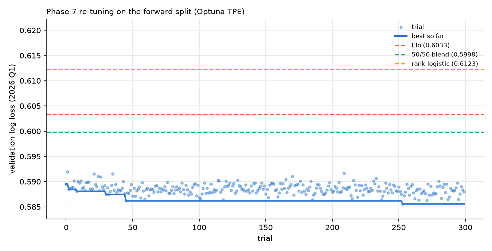
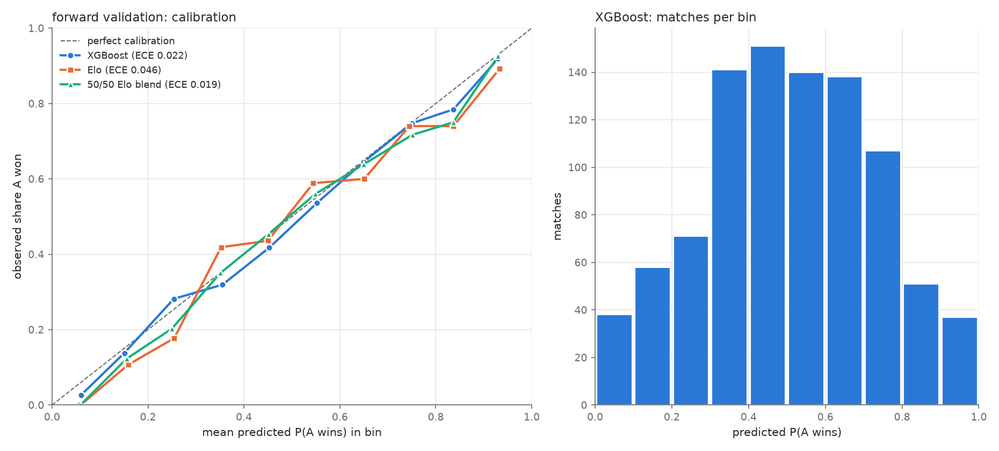
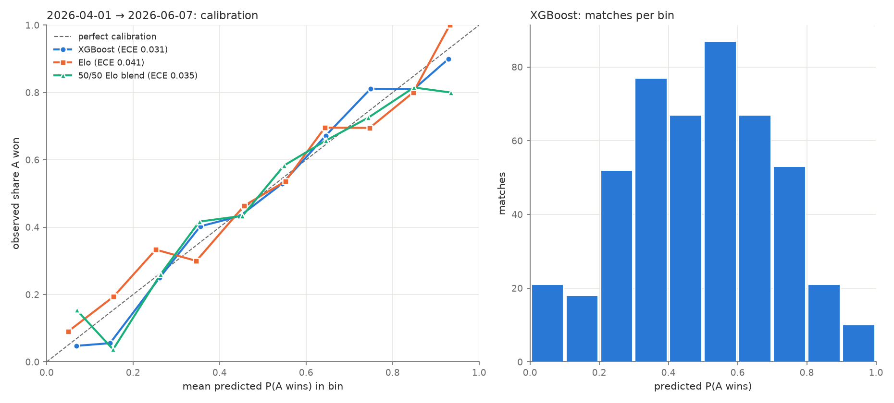

# Phase 7 — Forward test: 2026-04-01 → 2026-06-07

Generated by `python -m tennis.model.evaluate_final --split forward --score-test` · config hash `3c3f2599a311` · git `60741b3cd8589cb4a1961697528238c3fc515ffe`.

> **Single evaluation on the frozen config.** The test was scored exactly once (experiments/forward.jsonl, one record, config hash `3c3f2599a311`), after every setting was frozen in config.yaml (D-032). Nothing was changed after the test results were seen.

## Summary

- **Overall test (2026-04-01 → 2026-06-07, n = 473, all clay):** XGBoost accuracy **67.6%** [63.4%, 71.9%], log loss
  **0.592** [0.558, 0.627], Brier 0.203. The baselines on the same rows:

  | Baseline | Accuracy | Log loss |
  |---|---|---|
  | Elo | 67.0% | 0.605 |
  | 50/50 blend | 66.8% | 0.607 |
  | Surface Elo | 64.9% | 0.644 |
  | Rank logistic | 63.4% | 0.631 |

- **Paired log-loss differences (XGBoost − baseline):**
  - vs blend: −0.0149 [−0.0301, −0.0002]. This is significant, but only just.
  - vs Elo: −0.0130 [−0.0346, +0.0086]. The interval includes 0.
  - vs rank logistic: −0.0388 [−0.0647, −0.0117]. Significant.
  - The test gain over the blend is about the size of the validation gain (−0.014). With D-031's expected ~0.002 of
    selection optimism, that is consistent with a real but small improvement. Accuracy differences vs Elo and the
    blend are not significant.
- **Roland Garros 2026 (n = 118):** XGBoost 72.9% [65.3%, 80.5%], log loss 0.596.
  - Elo: 66.1%, log loss 0.618. Blend: 67.8%, log loss 0.615.
  - Paired log-loss differences are negative but include 0 vs Elo and vs the blend.
  - The accuracy CI is 15.3 points wide, so the gap to the overall result is within noise.
- **Sample size:** overall n = 473, accuracy CI 8.5 points wide (±4.2). Roland Garros n = 118, 15.3 points wide.
  There is no bookmaker baseline for 2026 (no odds data, D-029).

## Protocol

| Partition | Window (tourney_date) | Rows |
|---|---|---|
| Train | 2000-01-03 → 2025-12-17 | 75,016 |
| Validation | 2026-01-04 → 2026-03-30 | 932 |
| Test | 2026-04-01 → 2026-06-07 (all training-level matches); rows dated 2026-04-05 → 2026-05-25 | 473 |

- **Parameters:** xgb.forward_best_params (Phase 7 re-tuning on 2026 Q1).

```yaml
learning_rate: 0.02911925972933801
max_depth: 7
min_child_weight: 2.4281814628569753
subsample: 0.7764105185629614
colsample_bytree: 0.5174062612828937
gamma: 0.9969095174994491
reg_alpha: 7.8743942865995065
reg_lambda: 1.059396019764119
```

- **Validation step:** fit on train with early stopping on validation (100 rounds, ≤ 2000 trees). Best iteration 392 → **393 trees** for the final model.

- **Tree count:** the best re-tuning trial's `best_iteration + 1`, reproduced exactly by the validation step above.

- **Final model:** `train.refit_fixed` on train + validation with that FIXED tree count and no early-stopping set (D-028 retrain rule). It asserts max(refit date) ≤ `val_end`, no `match_id` shared with the test, test rows dated after every refit row, `maybe_augment_train(…, split_name)` on the training rows and `assert_not_augmented` on the test. The test is never an early-stopping set. `nthread` = 1, `tree_method` = hist, seed 42.

- **Baselines:** Elo, surface Elo and their 50/50 blend come from the pre-match feature columns; the rank logistic (D-026) is fitted on the training rows of each step (train for validation, train + validation for the test). Metrics: accuracy with half credit at p = 0.5, log loss (clip 1e-15), Brier; 2,000 bootstrap resamples, 95% percentile CIs, seed 42.

## Re-tuning on the validation window 2026-01-01 → 2026-03-31

Optuna TPE (seed 42) over `xgb.search_space`, 300 trials (≤ `xgb.n_trials_forward` = 300), trial log `experiments/xgb_trials_forward.jsonl` (validation metrics only; config hash `f703ebbdc434`). Early stopping AND selection both use the 2026 Q1 window (932 rows), so the validation numbers are optimistic; the test is the honest check. Best trial **253**: log loss 0.58557, accuracy 0.6867, 393 trees. Trial log loss: best 0.58557, median 0.58846, worst 0.59196.



| Trial | Log loss | Accuracy | Trees | learning_rate | max_depth | min_child_weight | subsample | colsample_bytree | gamma | reg_alpha | reg_lambda |
|---|---|---|---|---|---|---|---|---|---|---|---|
| 253 | 0.58557 | 0.6867 | 393 | 0.0291 | 7 | 2.43 | 0.776 | 0.517 | 0.997 | 7.87 | 1.06 |
| 45 | 0.58617 | 0.6824 | 570 | 0.0224 | 5 | 1.51 | 0.717 | 0.549 | 0.923 | 7.15 | 14.7 |
| 271 | 0.58627 | 0.6727 | 297 | 0.0297 | 7 | 2.7 | 0.773 | 0.54 | 0.953 | 8.3 | 1.73 |
| 265 | 0.58632 | 0.6749 | 418 | 0.0267 | 7 | 2.3 | 0.792 | 0.51 | 0.998 | 7.73 | 3.67 |
| 185 | 0.58638 | 0.6803 | 314 | 0.0214 | 7 | 2.76 | 0.902 | 0.525 | 0.916 | 7.03 | 1.8 |
| 237 | 0.58641 | 0.6856 | 425 | 0.0212 | 7 | 3.24 | 0.874 | 0.509 | 0.901 | 8.12 | 1.89 |
| 118 | 0.58641 | 0.6845 | 404 | 0.0335 | 7 | 2.62 | 0.79 | 0.526 | 0.963 | 8.3 | 4.76 |
| 295 | 0.58645 | 0.6792 | 296 | 0.0311 | 7 | 3.03 | 0.772 | 0.514 | 0.978 | 7.87 | 2.4 |
| 287 | 0.58646 | 0.6813 | 469 | 0.0244 | 7 | 2.22 | 0.795 | 0.537 | 0.989 | 7.9 | 1.4 |
| 59 | 0.58648 | 0.6792 | 522 | 0.0201 | 6 | 2.49 | 0.802 | 0.528 | 0.858 | 7.69 | 5.49 |

## Validation 2026-01-04 → 2026-03-30

Caveat: the validation window is also the early-stopping set (and, for the forward split, the selection set), so these numbers are optimistic. The Elo settings (D-027) were tuned on 2015–2024, before either validation window.

| Model | n | Accuracy | Log loss | Brier |
|---|---|---|---|---|
| **XGBoost (final)** | 932 | 0.6867 [0.6567, 0.7146] | 0.5856 [0.5577, 0.6118] | 0.2017 [0.1900, 0.2127] |
| Higher rank wins | 932 | 0.6481 [0.6186, 0.6792] | — | — |
| Rank logistic (log-rank ratio, fit on train) | 932 | 0.6491 [0.6196, 0.6803] | 0.6123 [0.5886, 0.6359] | 0.2126 [0.2021, 0.2230] |
| Elo | 932 | 0.6722 [0.6411, 0.7017] | 0.6033 [0.5787, 0.6294] | 0.2090 [0.1985, 0.2205] |
| Surface Elo | 932 | 0.6652 [0.6341, 0.6953] | 0.6080 [0.5816, 0.6354] | 0.2108 [0.1997, 0.2225] |
| 50/50 Elo + surface Elo | 932 | 0.6701 [0.6384, 0.7006] | 0.5998 [0.5757, 0.6253] | 0.2074 [0.1970, 0.2184] |

**Paired differences on validation, XGBoost − baseline** (paired bootstrap; negative log loss / Brier and positive accuracy favour XGBoost):

| Baseline | Δ log loss | Δ Brier | Δ accuracy |
|---|---|---|---|
| Elo | -0.0177 [-0.0330, -0.0034] | -0.0073 [-0.0140, -0.0012] | +0.0145 [-0.0097, +0.0392] |
| Surface Elo | -0.0224 [-0.0368, -0.0081] | -0.0091 [-0.0151, -0.0032] | +0.0215 [-0.0027, +0.0462] |
| 50/50 Elo + surface Elo | -0.0142 [-0.0272, -0.0015] | -0.0058 [-0.0114, -0.0004] | +0.0166 [-0.0059, +0.0402] |
| Rank logistic (log-rank ratio, fit on train) | -0.0267 [-0.0449, -0.0081] | -0.0109 [-0.0186, -0.0029] | +0.0376 [+0.0070, +0.0665] |

Validation accuracy 0.6867 ≤ 0.75 (leakage alarm checked). Calibration (ECE, 10 bins): xgb 0.0221, elo 0.0459, blend 0.0194.



## Test: 2026-04-01 → 2026-06-07

| Model | n | Accuracy | Log loss | Brier |
|---|---|---|---|---|
| **XGBoost (final)** | 473 | 0.6765 [0.6342, 0.7188] | 0.5920 [0.5576, 0.6272] | 0.2032 [0.1881, 0.2179] |
| Higher rank wins | 473 | 0.6342 [0.5899, 0.6786] | — | — |
| Rank logistic (log-rank ratio, fit on train) | 473 | 0.6342 [0.5899, 0.6786] | 0.6308 [0.5937, 0.6683] | 0.2204 [0.2044, 0.2367] |
| Elo | 473 | 0.6702 [0.6279, 0.7125] | 0.6050 [0.5668, 0.6437] | 0.2087 [0.1923, 0.2247] |
| Surface Elo | 473 | 0.6490 [0.6025, 0.6934] | 0.6436 [0.6005, 0.6860] | 0.2235 [0.2060, 0.2409] |
| 50/50 Elo + surface Elo | 473 | 0.6681 [0.6237, 0.7104] | 0.6069 [0.5707, 0.6436] | 0.2100 [0.1942, 0.2255] |

**Paired differences on the test, XGBoost − baseline** (paired bootstrap; negative log loss / Brier and positive accuracy favour XGBoost):

| Baseline | Δ log loss | Δ Brier | Δ accuracy |
|---|---|---|---|
| Elo | -0.0130 [-0.0346, +0.0086] | -0.0055 [-0.0150, +0.0040] | +0.0063 [-0.0317, +0.0465] |
| Surface Elo | -0.0517 [-0.0761, -0.0278] | -0.0203 [-0.0299, -0.0105] | +0.0275 [-0.0085, +0.0655] |
| 50/50 Elo + surface Elo | -0.0149 [-0.0301, -0.0002] | -0.0068 [-0.0137, -0.0002] | +0.0085 [-0.0233, +0.0444] |
| Rank logistic (log-rank ratio, fit on train) | -0.0388 [-0.0647, -0.0117] | -0.0172 [-0.0286, -0.0060] | +0.0423 [+0.0042, +0.0846] |

**Small sample.** n = 473: the 95% CI of the XGBoost accuracy is [0.634, 0.719], 8.5 points wide (± 4.2). Compare models with the paired differences above, not by eye from these marginal CIs.

### Roland Garros 2026

| Model | n | Accuracy | Log loss | Brier |
|---|---|---|---|---|
| **XGBoost (final)** | 118 | 0.7288 [0.6525, 0.8051] | 0.5958 [0.4984, 0.7046] | 0.1981 [0.1620, 0.2364] |
| Higher rank wins | 118 | 0.6441 [0.5593, 0.7288] | — | — |
| Rank logistic (log-rank ratio, fit on train) | 118 | 0.6441 [0.5593, 0.7288] | 0.6469 [0.5704, 0.7323] | 0.2255 [0.1923, 0.2609] |
| Elo | 118 | 0.6610 [0.5763, 0.7458] | 0.6179 [0.5310, 0.7118] | 0.2101 [0.1757, 0.2460] |
| Surface Elo | 118 | 0.6695 [0.5847, 0.7627] | 0.6457 [0.5440, 0.7582] | 0.2180 [0.1795, 0.2587] |
| 50/50 Elo + surface Elo | 118 | 0.6780 [0.5932, 0.7627] | 0.6154 [0.5305, 0.7090] | 0.2093 [0.1750, 0.2463] |

**Paired differences on Roland Garros, XGBoost − baseline** (paired bootstrap; negative log loss / Brier and positive accuracy favour XGBoost):

| Baseline | Δ log loss | Δ Brier | Δ accuracy |
|---|---|---|---|
| Elo | -0.0221 [-0.0643, +0.0209] | -0.0119 [-0.0287, +0.0047] | +0.0678 [+0.0000, +0.1356] |
| Surface Elo | -0.0499 [-0.0927, -0.0052] | -0.0199 [-0.0357, -0.0041] | +0.0593 [-0.0254, +0.1441] |
| 50/50 Elo + surface Elo | -0.0196 [-0.0492, +0.0115] | -0.0112 [-0.0226, -0.0002] | +0.0508 [-0.0169, +0.1186] |
| Rank logistic (log-rank ratio, fit on train) | -0.0511 [-0.1083, +0.0106] | -0.0273 [-0.0496, -0.0049] | +0.0847 [+0.0169, +0.1525] |

**Small sample.** n = 118: accuracy CI [0.653, 0.805], 15.3 points wide.

No bookmaker baseline: no odds data are used (D-029), and there is no published 2026 figure.

### Calibration

ECE (10 bins): xgb 0.0311, elo 0.0413, blend 0.0347. With this few rows per bin the curve is noisy.



### Test by round

| Round | n | XGB acc [95% CI] | Elo acc | Blend acc | XGB log loss | Elo log loss | Blend log loss |
|---|---|---|---|---|---|---|---|
| R128 | 123 | 0.659 [0.577, 0.740] | 0.577 | 0.675 | 0.6137 | 0.6524 | 0.6389 |
| R64 | 112 | 0.652 [0.562, 0.732] | 0.652 | 0.625 | 0.6231 | 0.6523 | 0.6457 |
| R32 | 122 | 0.738 [0.664, 0.811] | 0.746 | 0.730 | 0.5411 | 0.5333 | 0.5430 |
| R16 | 62 | 0.629 [0.500, 0.742] | 0.694 | 0.581 | 0.6165 | 0.6224 | 0.6358 |
| QF | 31 | 0.645 [0.484, 0.806] | 0.677 | 0.677 | 0.5877 | 0.5708 | 0.5699 |
| SF | 15 | 0.800 [0.600, 1.000] | 0.733 | 0.800 | 0.5206 | 0.5144 | 0.5386 |
| F | 8 | 0.625 [0.250, 1.000] | 0.875 | 0.625 | 0.5589 | 0.4729 | 0.5915 |

### Test by surface

| Surface | n | XGB acc [95% CI] | Elo acc | Blend acc | XGB log loss | Elo log loss | Blend log loss |
|---|---|---|---|---|---|---|---|
| Clay | 473 | 0.677 [0.634, 0.719] | 0.670 | 0.668 | 0.5920 | 0.6050 | 0.6069 |

### Test by level

| Level | n | XGB acc [95% CI] | Elo acc | Blend acc | XGB log loss | Elo log loss | Blend log loss |
|---|---|---|---|---|---|---|---|
| A | 118 | 0.686 [0.602, 0.771] | 0.729 | 0.678 | 0.5837 | 0.5793 | 0.5959 |
| G | 118 | 0.729 [0.653, 0.805] | 0.661 | 0.678 | 0.5958 | 0.6179 | 0.6154 |
| M | 237 | 0.646 [0.582, 0.705] | 0.646 | 0.658 | 0.5942 | 0.6113 | 0.6081 |

## Disclosures

- **D-028 finding 2:** Elo-only accuracies for the FULL 2025 and 2026 seasons (63.71% / 64.91%, untuned default Elo) appeared earlier in `reports/audits/phase2.md` and in PROGRESS.md. Those seasons contain Wimbledon 2025 and the forward test window. Nothing was selected on them (Phase 4 tuned on 2015–2024 only, verified by leakage test 17), but the numbers were seen before this test.

- **Elo tuning window:** Elo settings were chosen on 2015–2024 (D-027), before both test periods; it overlaps the Phase 5 dev validation window (D-004), which affects Elo, the blend and XGBoost alike.

- **Selection optimism (D-031):** the Phase 5 audit estimated that about 0.002 of the dev-split log-loss gain over the blend (−0.012) was selection optimism (about −0.010 survives without early stopping on the selection window). A test gain over the blend somewhat smaller than the validation gain is therefore expected. The forward parameters were re-selected on 2026 Q1, so the same kind of optimism applies to its validation numbers.

- **Retirements:** RET/DEF matches are never labels and walkovers are dropped (D-022), so accuracies are slightly optimistic relative to all matches played.

- **Shortened forward test (D-017):** the archive ends with Roland Garros 2026; there is no June–November 2026 data, so the test covers 2026-04-01 → 2026-06-07 only.
