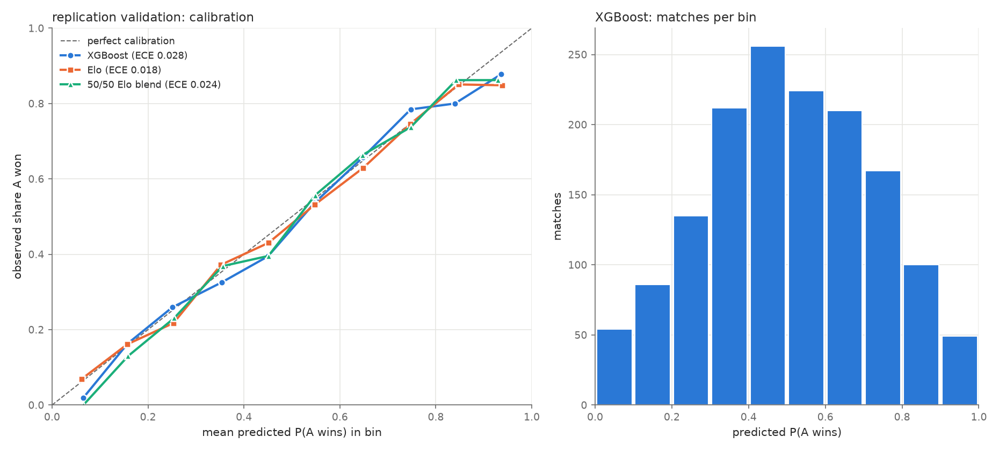
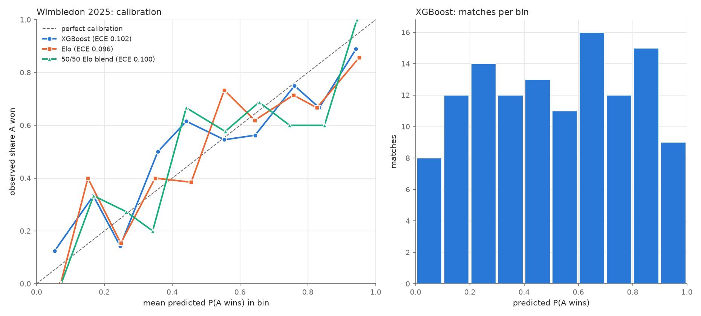

# Phase 6 — Replication backtest: Wimbledon 2025

Generated by `python -m tennis.model.evaluate_final --split replication --score-test` · config hash `3c3f2599a311` · git `60741b3cd8589cb4a1961697528238c3fc515ffe`.

> **Single evaluation on the frozen config.** The test was scored exactly once (experiments/replication.jsonl, one record, config hash `3c3f2599a311`), after every setting was frozen in config.yaml (D-032). Nothing was changed after the test results were seen.

## Summary

- **XGBoost on Wimbledon 2025 (n = 122):** accuracy **65.6%** [57.4%, 73.8%], log loss **0.616**
  [0.524, 0.717], Brier 0.213. This is close to the original author's 66.3% and above IBM's 63.8%. Both are quoted
  figures, not computed on our rows. It is below the ~72% quoted for bookmakers, which is also quoted only, with no
  CI (D-029).
- **XGBoost did not beat the simple baselines on this tournament.**
  - Elo alone scored 69.7% with log loss 0.614.
  - The 50/50 Elo blend had log loss 0.604.
  - Paired differences (XGBoost − baseline) in log loss: vs Elo +0.002 [−0.045, +0.050]; vs blend +0.012
    [−0.023, +0.049]; vs rank logistic −0.002 [−0.066, +0.061].
  - Every interval includes 0. On 122 matches the test cannot tell these models apart.
- **Validation looked better than the test.** On 2025 H1 validation (n = 1,493), XGBoost beat the blend by −0.013
  log loss [−0.021, −0.005]. D-031 expected about 0.002 of the dev gain to be selection optimism. Wimbledon's
  +0.012 is well within this tiny sample's noise, so it neither confirms nor refutes that gain. The larger forward
  test (`reports/forward_test_2026.md`) is the better check.
- **Sample size:** the 95% CI on accuracy is 16.4 points wide (±8.2), as PLAN.md section 7 warned for one Slam.

## Protocol

| Partition | Window (tourney_date) | Rows |
|---|---|---|
| Train | 2000-01-03 → 2024-12-30 | 72,291 |
| Validation | 2025-01-06 → 2025-06-23 | 1,493 |
| Test | Wimbledon 2025 (main draw, tourney_date after 2025-06-29); rows dated 2025-06-30 → 2025-06-30 | 122 |

- **Parameters:** xgb.best_params (Phase 5 dev tuning, D-030).

```yaml
learning_rate: 0.017403824245571284
max_depth: 7
min_child_weight: 3.7070046985199285
subsample: 0.7246419405377439
colsample_bytree: 0.5151019491450788
gamma: 0.1045539002555385
reg_alpha: 0.06810140421533839
reg_lambda: 3.0385256550684665
```

- **Validation step:** fit on train with early stopping on validation (100 rounds, ≤ 2000 trees). Best iteration 404 → **405 trees** for the final model.

- **Tree count choice:** the validation run's `best_iteration + 1` on the replication validation window (405). Alternative: the dev early-stopping count `xgb.best_params.n_estimators = 689` (D-030), fitted on 2000–2022 with 2023–24 for early stopping. We use the count measured closest to the test, on the window the final model is refitted through.

- **Final model:** `train.refit_fixed` on train + validation with that FIXED tree count and no early-stopping set (D-028 retrain rule). It asserts max(refit date) ≤ `val_end`, no `match_id` shared with the test, test rows dated after every refit row, `maybe_augment_train(…, split_name)` on the training rows and `assert_not_augmented` on the test. The test is never an early-stopping set. `nthread` = 1, `tree_method` = hist, seed 42.

- **Baselines:** Elo, surface Elo and their 50/50 blend come from the pre-match feature columns; the rank logistic (D-026) is fitted on the training rows of each step (train for validation, train + validation for the test). Metrics: accuracy with half credit at p = 0.5, log loss (clip 1e-15), Brier; 2,000 bootstrap resamples, 95% percentile CIs, seed 42.

## Validation 2025-01-06 → 2025-06-23

Caveat: the validation window is also the early-stopping set (and, for the forward split, the selection set), so these numbers are optimistic. The Elo settings (D-027) were tuned on 2015–2024, before either validation window.

| Model | n | Accuracy | Log loss | Brier |
|---|---|---|---|---|
| **XGBoost (final)** | 1,493 | 0.6932 [0.6698, 0.7160] | 0.5857 [0.5662, 0.6064] | 0.2009 [0.1926, 0.2098] |
| Higher rank wins | 1,493 | 0.6581 [0.6346, 0.6815] | — | — |
| Rank logistic (log-rank ratio, fit on train) | 1,493 | 0.6581 [0.6346, 0.6815] | 0.6243 [0.6053, 0.6429] | 0.2173 [0.2091, 0.2254] |
| Elo | 1,493 | 0.6685 [0.6453, 0.6922] | 0.6029 [0.5838, 0.6240] | 0.2082 [0.2000, 0.2173] |
| Surface Elo | 1,493 | 0.6551 [0.6306, 0.6792] | 0.6160 [0.5955, 0.6374] | 0.2136 [0.2050, 0.2226] |
| 50/50 Elo + surface Elo | 1,493 | 0.6792 [0.6554, 0.7023] | 0.5986 [0.5804, 0.6178] | 0.2063 [0.1985, 0.2147] |

**Paired differences on validation, XGBoost − baseline** (paired bootstrap; negative log loss / Brier and positive accuracy favour XGBoost):

| Baseline | Δ log loss | Δ Brier | Δ accuracy |
|---|---|---|---|
| Elo | -0.0172 [-0.0278, -0.0070] | -0.0073 [-0.0118, -0.0030] | +0.0248 [+0.0057, +0.0425] |
| Surface Elo | -0.0303 [-0.0422, -0.0186] | -0.0128 [-0.0178, -0.0080] | +0.0382 [+0.0181, +0.0569] |
| 50/50 Elo + surface Elo | -0.0129 [-0.0212, -0.0046] | -0.0054 [-0.0088, -0.0020] | +0.0141 [-0.0030, +0.0298] |
| Rank logistic (log-rank ratio, fit on train) | -0.0386 [-0.0524, -0.0248] | -0.0164 [-0.0224, -0.0106] | +0.0352 [+0.0131, +0.0566] |

Validation accuracy 0.6932 ≤ 0.75 (leakage alarm checked). Calibration (ECE, 10 bins): xgb 0.0280, elo 0.0182, blend 0.0242.



## Test: Wimbledon 2025

| Model | n | Accuracy | Log loss | Brier |
|---|---|---|---|---|
| **XGBoost (final)** | 122 | 0.6557 [0.5736, 0.7377] | 0.6162 [0.5238, 0.7173] | 0.2134 [0.1761, 0.2545] |
| Higher rank wins | 122 | 0.6639 [0.5738, 0.7459] | — | — |
| Rank logistic (log-rank ratio, fit on train) | 122 | 0.6639 [0.5738, 0.7459] | 0.6184 [0.5426, 0.6994] | 0.2137 [0.1819, 0.2478] |
| Elo | 122 | 0.6967 [0.6066, 0.7787] | 0.6139 [0.5318, 0.7043] | 0.2119 [0.1777, 0.2499] |
| Surface Elo | 122 | 0.6311 [0.5410, 0.7131] | 0.6501 [0.5649, 0.7400] | 0.2300 [0.1944, 0.2678] |
| 50/50 Elo + surface Elo | 122 | 0.6475 [0.5574, 0.7295] | 0.6041 [0.5335, 0.6770] | 0.2105 [0.1792, 0.2421] |

**Paired differences on the test, XGBoost − baseline** (paired bootstrap; negative log loss / Brier and positive accuracy favour XGBoost):

| Baseline | Δ log loss | Δ Brier | Δ accuracy |
|---|---|---|---|
| Elo | +0.0023 [-0.0451, +0.0498] | +0.0015 [-0.0167, +0.0206] | -0.0410 [-0.1066, +0.0164] |
| Surface Elo | -0.0339 [-0.0985, +0.0282] | -0.0166 [-0.0433, +0.0094] | +0.0246 [-0.0492, +0.0984] |
| 50/50 Elo + surface Elo | +0.0122 [-0.0227, +0.0485] | +0.0029 [-0.0109, +0.0171] | +0.0082 [-0.0410, +0.0574] |
| Rank logistic (log-rank ratio, fit on train) | -0.0022 [-0.0658, +0.0607] | -0.0002 [-0.0259, +0.0245] | -0.0082 [-0.0740, +0.0574] |

**Small sample.** n = 122: the 95% CI of the XGBoost accuracy is [0.574, 0.738], 16.4 points wide (± 8.2). Compare models with the paired differences above, not by eye from these marginal CIs.

### Published reference points

| Model | Accuracy | Basis |
|---|---|---|
| **This model (XGBoost)** | 0.656 [0.574, 0.738] | our test rows |
| Original author (published) | 0.663 | quoted, not computed on our rows; no CI |
| IBM (published) | 0.638 | quoted, not computed on our rows; no CI |
| Bookmakers (quoted externally, D-029) | 0.720 | quoted, not computed on our rows; no CI |

The published figures are on their authors' own match sets (which may include retirements or count matches differently); they are not like-for-like comparisons. The bookmaker figure is the PLAN.md quote; no odds data are used (D-029).

### Calibration

ECE (10 bins): xgb 0.1024, elo 0.0957, blend 0.0999. With this few rows per bin the curve is noisy.



### Test by round

| Round | n | XGB acc [95% CI] | Elo acc | Blend acc | XGB log loss | Elo log loss | Blend log loss |
|---|---|---|---|---|---|---|---|
| R128 | 61 | 0.623 [0.508, 0.738] | 0.656 | 0.639 | 0.6966 | 0.6893 | 0.6703 |
| R64 | 32 | 0.594 [0.438, 0.781] | 0.594 | 0.594 | 0.6710 | 0.6622 | 0.6307 |
| R32 | 16 | 0.750 [0.500, 0.938] | 0.812 | 0.688 | 0.4027 | 0.4444 | 0.4218 |
| R16 | 6 | 0.833 [0.500, 1.000] | 1.000 | 0.833 | 0.3948 | 0.3984 | 0.4968 |
| QF | 4 | 1.000 [1.000, 1.000] | 1.000 | 1.000 | 0.1788 | 0.2035 | 0.2154 |
| SF | 2 | 1.000 [1.000, 1.000] | 1.000 | 0.500 | 0.2683 | 0.3922 | 0.5954 |
| F | 1 | 0.000 [0.000, 0.000] | 1.000 | 0.000 | 1.1510 | 0.5625 | 0.8473 |

## Disclosures

- **D-028 finding 2:** Elo-only accuracies for the FULL 2025 and 2026 seasons (63.71% / 64.91%, untuned default Elo) appeared earlier in `reports/audits/phase2.md` and in PROGRESS.md. Those seasons contain Wimbledon 2025 and the forward test window. Nothing was selected on them (Phase 4 tuned on 2015–2024 only, verified by leakage test 17), but the numbers were seen before this test.

- **Elo tuning window:** Elo settings were chosen on 2015–2024 (D-027), before both test periods; it overlaps the Phase 5 dev validation window (D-004), which affects Elo, the blend and XGBoost alike.

- **Selection optimism (D-031):** the Phase 5 audit estimated that about 0.002 of the dev-split log-loss gain over the blend (−0.012) was selection optimism (about −0.010 survives without early stopping on the selection window). A test gain over the blend somewhat smaller than the validation gain is therefore expected.

- **Retirements:** RET/DEF matches are never labels and walkovers are dropped (D-022), so accuracies are slightly optimistic relative to all matches played.

- **Unassigned rows:** events starting after 2025-06-29 other than Wimbledon 2025 belong to no partition of this split (D-026).

- **Parameters** were tuned on the dev split (train 2000–2022, validation 2023–24, D-030); the replication test played no part in any choice.
