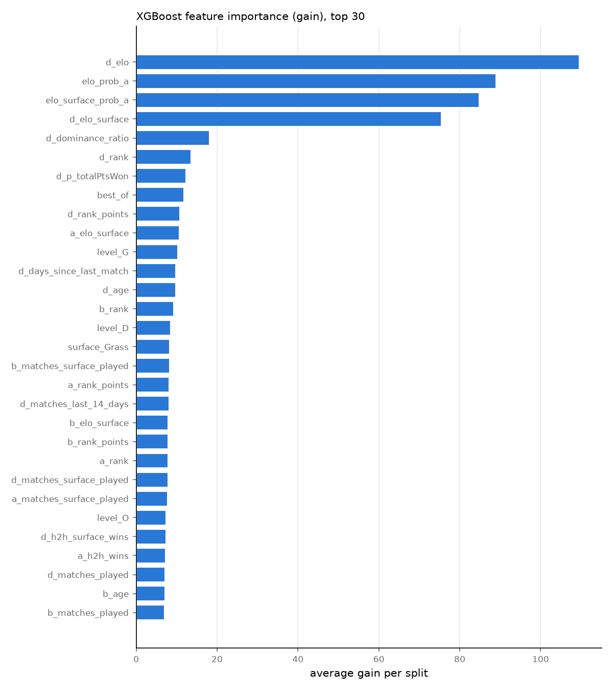
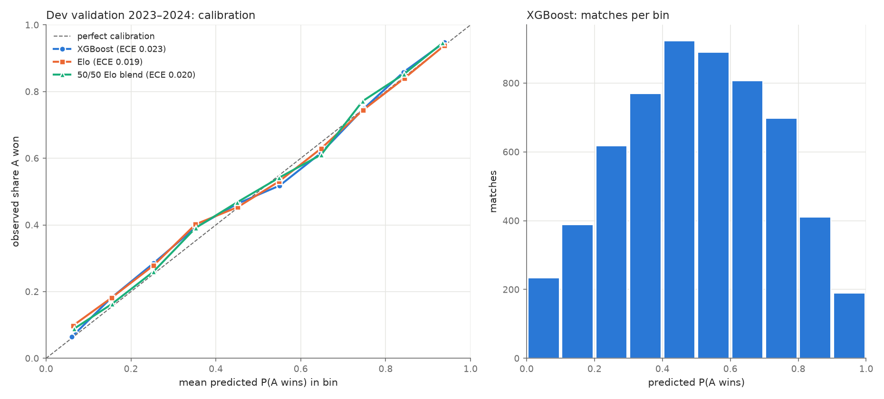
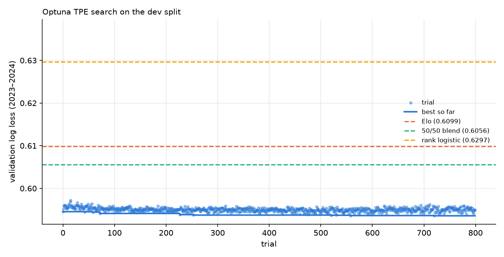

# Phase 5 — XGBoost on the dev split

Generated by `python -m tennis.model.tune` · config hash `1f47f5c50fc9` · git `6919e78c494b0bd10a7bf7118ba38da5f9024e51`. Trials: `experiments/xgb_trials.jsonl`; refit and sanity runs: `experiments/xgb_final.jsonl`; model: `models/xgb_dev_1f47f5c50fc9.json` (+ `_meta.json`).

**Split:** dev (D-004): train 2000-01-03 → 2022-11-27 (66,363 rows), validation 2023-01-02 → 2024-12-30 (5,928 rows). No test partition exists in this split: Wimbledon 2025 and the 2026 test window were never loaded.

**Inputs:** the 106 allow-listed columns of `config.model.features` (`dataset.feature_columns`); NaN left to XGBoost's native missing handling; no fitted preprocessing. `maybe_augment_train(train, cfg, 'dev')` and `assert_not_augmented(val)` on every fit (D-024 R2); `features.flip_augment_train` = False.

**Search:** Optuna TPE (multivariate, seed 42) over `xgb.search_space`, learning_rate log-uniform; 800 of 800 requested trials finished in 77.2 min on 8 processes × 1 thread. `binary:logistic`, logloss, `tree_method=hist`, early stopping 100 rounds on validation, ≤ 2000 rounds. Selection: validation log loss, accuracy as tie-breaker. The best trial was refitted and reproduced exactly (best iteration 688, refit 26s).

**Caveats.** (1) Early stopping AND selection both use the 2023–24 validation window, so the XGBoost validation numbers are optimistically biased (selection over hundreds of trials on one window); the honest numbers come from the Phase 6/7 test sets. (2) The Elo settings in the features (D-027) were tuned on 2015–2024, which includes this validation window (D-004) — this affects Elo, the blend and XGBoost alike. (3) With parallel asynchronous trials the trial sequence is not bit-reproducible; each trial is. (4) RET/DEF matches are not labels (D-022), so accuracies are slightly optimistic vs all matches.

## Best parameters

Trial 720:

```yaml
xgb:
  best_params:
    learning_rate: 0.0174038
    max_depth: 7
    min_child_weight: 3.707
    subsample: 0.724642
    colsample_bytree: 0.515102
    gamma: 0.104554
    reg_alpha: 0.0681014
    reg_lambda: 3.03853
    n_estimators: 689   # trees at the dev early-stopping point (best_iteration + 1)
```

## Validation 2023–2024 vs baselines

95% percentile bootstrap CIs (2,000 resamples, seed 42).

| Model | n | Accuracy | Log loss | Brier |
|---|---|---|---|---|
| **XGBoost (tuned)** | 5,928 | 0.6672 [0.6557, 0.6791] | 0.5936 [0.5831, 0.6048] | 0.2050 [0.2005, 0.2099] |
| Higher rank wins | 5,928 | 0.6385 [0.6259, 0.6504] | — | — |
| Rank logistic (log-rank ratio, fit on train) | 5,928 | 0.6385 [0.6259, 0.6504] | 0.6297 [0.6196, 0.6395] | 0.2202 [0.2158, 0.2246] |
| Elo | 5,928 | 0.6553 [0.6430, 0.6666] | 0.6099 [0.5997, 0.6207] | 0.2118 [0.2075, 0.2163] |
| Surface Elo | 5,928 | 0.6452 [0.6334, 0.6576] | 0.6214 [0.6098, 0.6325] | 0.2167 [0.2119, 0.2214] |
| 50/50 Elo + surface Elo | 5,928 | 0.6565 [0.6447, 0.6684] | 0.6056 [0.5957, 0.6156] | 0.2102 [0.2060, 0.2145] |
| Bookmaker (implied, margin removed) | — | TODO (Phase 6/7; odds blocked, D-025) | TODO | TODO |

**Paired differences, XGBoost − baseline** (same rows, paired bootstrap; negative log loss / Brier and positive accuracy favour XGBoost):

| Baseline | Δ log loss | Δ Brier | Δ accuracy |
|---|---|---|---|
| Elo | -0.0163 [-0.0217, -0.0111] | -0.0067 [-0.0090, -0.0046] | +0.0119 [+0.0024, +0.0219] |
| Surface Elo | -0.0278 [-0.0340, -0.0214] | -0.0117 [-0.0143, -0.0091] | +0.0220 [+0.0127, +0.0315] |
| 50/50 Elo + surface Elo | -0.0120 [-0.0163, -0.0075] | -0.0051 [-0.0069, -0.0033] | +0.0107 [+0.0023, +0.0188] |
| Rank logistic (log-rank ratio, fit on train) | -0.0361 [-0.0437, -0.0289] | -0.0151 [-0.0185, -0.0121] | +0.0287 [+0.0170, +0.0406] |

### Validation by season

| Season | n | XGB acc | Elo acc | Blend acc | XGB log loss | Elo log loss | Blend log loss |
|---|---|---|---|---|---|---|---|
| 2023 | 2,888 | 0.666 [0.648, 0.682] | 0.656 | 0.654 | 0.6014 | 0.6131 | 0.6098 |
| 2024 | 3,040 | 0.669 [0.652, 0.686] | 0.654 | 0.659 | 0.5862 | 0.6068 | 0.6016 |

### Validation by surface

| Surface | n | XGB acc | Elo acc | Blend acc | XGB log loss | Elo log loss | Blend log loss |
|---|---|---|---|---|---|---|---|
| Clay | 1,822 | 0.664 [0.643, 0.686] | 0.635 | 0.647 | 0.5973 | 0.6264 | 0.6159 |
| Grass | 640 | 0.678 [0.642, 0.713] | 0.664 | 0.634 | 0.5890 | 0.5990 | 0.6092 |
| Hard | 3,466 | 0.667 [0.651, 0.683] | 0.664 | 0.665 | 0.5924 | 0.6032 | 0.5995 |

### Validation by level

| Level | n | XGB acc | Elo acc | Blend acc | XGB log loss | Elo log loss | Blend log loss |
|---|---|---|---|---|---|---|---|
| A | 3,041 | 0.644 [0.626, 0.660] | 0.639 | 0.639 | 0.6174 | 0.6260 | 0.6253 |
| G | 983 | 0.745 [0.717, 0.771] | 0.715 | 0.715 | 0.5068 | 0.5375 | 0.5323 |
| M | 1,344 | 0.652 [0.626, 0.676] | 0.643 | 0.645 | 0.6121 | 0.6326 | 0.6216 |
| F | 29 | 0.724 [0.552, 0.862] | 0.690 | 0.690 | 0.5584 | 0.5696 | 0.5651 |
| D | 468 | 0.686 [0.643, 0.726] | 0.657 | 0.663 | 0.5887 | 0.6133 | 0.6061 |
| O | 63 | 0.762 [0.651, 0.857] | 0.730 | 0.778 | 0.4559 | 0.4697 | 0.4735 |

### Validation by round

| Round | n | XGB acc | Elo acc | Blend acc | XGB log loss | Elo log loss | Blend log loss |
|---|---|---|---|---|---|---|---|
| R128 | 810 | 0.675 [0.643, 0.709] | 0.651 | 0.648 | 0.5690 | 0.5985 | 0.5908 |
| R64 | 866 | 0.664 [0.632, 0.695] | 0.657 | 0.665 | 0.5902 | 0.6051 | 0.5959 |
| R32 | 1,753 | 0.671 [0.649, 0.694] | 0.654 | 0.653 | 0.5965 | 0.6067 | 0.6058 |
| R16 | 1,008 | 0.664 [0.635, 0.692] | 0.674 | 0.667 | 0.5961 | 0.6157 | 0.6083 |
| RR | 591 | 0.675 [0.638, 0.712] | 0.656 | 0.657 | 0.5909 | 0.6140 | 0.6086 |
| QF | 497 | 0.652 [0.610, 0.694] | 0.650 | 0.662 | 0.6144 | 0.6168 | 0.6160 |
| SF | 265 | 0.664 [0.608, 0.721] | 0.626 | 0.645 | 0.6049 | 0.6235 | 0.6201 |
| BR | 1 | 1.000 [1.000, 1.000] | 0.000 | 1.000 | 0.5711 | 0.6962 | 0.6059 |
| F | 137 | 0.635 [0.555, 0.708] | 0.628 | 0.613 | 0.6187 | 0.6341 | 0.6520 |

Subgroups above 0.75: level O (0.762, n=63); round BR (1.000, n=1). Full-window and per-season accuracies are all ≤ 0.75 (checked by `leakage_alarm`).

## Feature importance



| Rank (gain) | Feature | Gain (avg per split) | Total gain | Rank (total gain) |
|---|---|---|---|---|
| 1 | d_elo | 109.56 | 112,084 | 1 |
| 2 | elo_prob_a | 89.01 | 49,310 | 4 |
| 3 | elo_surface_prob_a | 84.84 | 52,008 | 3 |
| 4 | d_elo_surface | 75.47 | 81,357 | 2 |
| 5 | d_dominance_ratio | 18.14 | 13,113 | 7 |
| 6 | d_rank | 13.58 | 14,487 | 5 |
| 7 | d_p_totalPtsWon | 12.26 | 8,078 | 10 |
| 8 | best_of | 11.79 | 2,994 | 70 |
| 9 | d_rank_points | 10.83 | 9,524 | 8 |
| 10 | a_elo_surface | 10.70 | 7,653 | 12 |
| 11 | level_G | 10.29 | 1,255 | 86 |
| 12 | d_days_since_last_match | 9.83 | 6,825 | 14 |
| 13 | d_age | 9.72 | 13,169 | 6 |
| 14 | b_rank | 9.28 | 7,407 | 13 |
| 15 | level_D | 8.51 | 187 | 103 |
| 16 | surface_Grass | 8.28 | 207 | 102 |
| 17 | b_matches_surface_played | 8.26 | 8,504 | 9 |
| 18 | a_rank_points | 8.20 | 6,608 | 16 |
| 19 | d_matches_last_14_days | 8.18 | 4,570 | 45 |
| 20 | b_elo_surface | 7.92 | 5,321 | 29 |
| 21 | b_rank_points | 7.91 | 5,729 | 19 |
| 22 | a_rank | 7.90 | 5,505 | 26 |
| 23 | d_matches_surface_played | 7.83 | 6,721 | 15 |
| 24 | a_matches_surface_played | 7.81 | 7,766 | 11 |
| 25 | level_O | 7.40 | 96 | 105 |
| 26 | d_h2h_surface_wins | 7.35 | 874 | 90 |
| 27 | a_h2h_wins | 7.23 | 984 | 89 |
| 28 | d_matches_played | 7.17 | 5,569 | 24 |
| 29 | b_age | 7.06 | 6,492 | 17 |
| 30 | b_matches_played | 7.05 | 4,392 | 49 |

Features never used in a split: none.

**Height (D-024 R1):** `b_height` rank 71 by gain, 76 by total gain; `d_height` rank 79 by gain, 72 by total gain; `a_height` rank 93 by gain, 77 by total gain (of 106). None is in the gain top 15: keep them (no action under R1).

## Calibration



Expected calibration error (10 bins): XGBoost 0.0232, Elo 0.0186, 50/50 blend 0.0205.

## Search history



| Trial | Log loss | Accuracy | Trees | learning_rate | max_depth | min_child_weight | subsample | colsample_bytree | gamma | reg_alpha | reg_lambda |
|---|---|---|---|---|---|---|---|---|---|---|---|
| 720 | 0.59357 | 0.6672 | 689 | 0.0174 | 7 | 3.71 | 0.725 | 0.515 | 0.105 | 0.0681 | 3.04 |
| 558 | 0.59362 | 0.6663 | 534 | 0.0158 | 7 | 2.8 | 0.72 | 0.505 | 0.0346 | 0.804 | 5.33 |
| 520 | 0.59370 | 0.6662 | 542 | 0.0153 | 7 | 2.45 | 0.722 | 0.511 | 0.109 | 0.189 | 5.06 |
| 253 | 0.59373 | 0.6636 | 683 | 0.0156 | 7 | 3.24 | 0.723 | 0.555 | 0.152 | 0.803 | 2.88 |
| 530 | 0.59381 | 0.6668 | 634 | 0.0161 | 7 | 2.66 | 0.722 | 0.533 | 0.0525 | 0.0889 | 3.61 |
| 476 | 0.59384 | 0.6662 | 549 | 0.0165 | 7 | 2.97 | 0.718 | 0.523 | 0.133 | 0.98 | 1.49 |
| 227 | 0.59384 | 0.6668 | 519 | 0.0167 | 7 | 4.24 | 0.724 | 0.536 | 0.126 | 0.509 | 3.84 |
| 739 | 0.59389 | 0.6630 | 529 | 0.0158 | 7 | 1.97 | 0.686 | 0.53 | 0.176 | 0.204 | 6.24 |
| 782 | 0.59390 | 0.6660 | 525 | 0.0154 | 7 | 2.38 | 0.711 | 0.506 | 0.228 | 0.0437 | 7.2 |
| 469 | 0.59391 | 0.6672 | 532 | 0.0159 | 7 | 4.06 | 0.721 | 0.504 | 0.122 | 0.504 | 3.88 |

Trial log loss: best 0.59357, median 0.59502, worst 0.59714; 800 of 800 trials beat Elo-only (0.6099), 800 beat the blend (0.6056). Mean trial time 46.0s.

## Shuffled-label sanity check

Best parameters retrained on PERMUTED training labels (seed 42), scored on the real validation labels: accuracy **0.4889**, log loss 0.6932 (ln 2 = 0.6931), 1 trees before early stopping. Expected band [0.47, 0.53]: PASS.

## Acceptance (Phase 5)

| Check | Result |
|---|---|
| Beats Elo-only on val log loss | 0.5936 vs 0.6099: Δ -0.0163 [-0.0217, -0.0111] |
| Beats the blend on val log loss | 0.5936 vs 0.6056: Δ -0.0120 [-0.0163, -0.0075] |
| Val accuracy ≤ 0.75 | 0.6672 |
| Shuffled labels ≈ 0.5 | 0.4889 |
